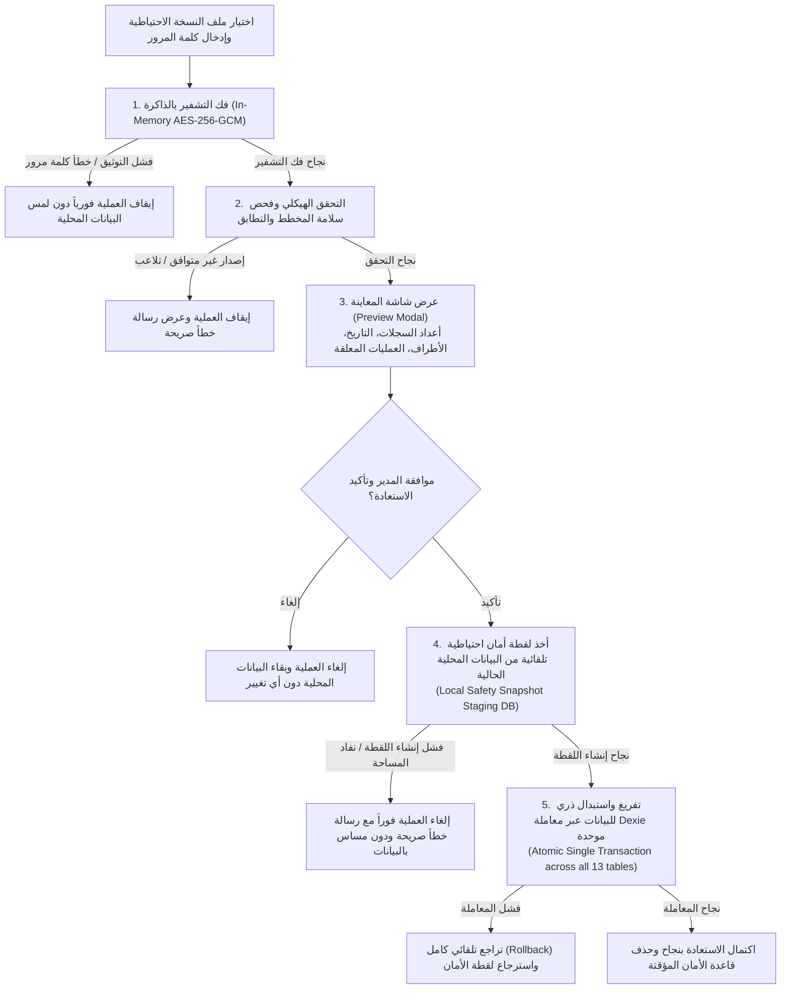

# وثيقة التصميم الهندسي لمنظومة النسخ الاحتياطي والاستعادة واستدامة التخزين
## المرحلة 2b-3: التصميم المعماري للنسخ الاحتياطي اليدوي، السحابي، وحماية iOS
*(Backup, Restore, Cloud Scheduling & iOS Persistence Architecture)*

---

### جدول المحتويات
1. [هيكل وتنسيق الملف المشفر (Encrypted File Format)](#1-هيكل-وتنسيق-الملف-المشفر-encrypted-file-format)
2. [محتويات النسخة الاحتياطية وحدود الشمول والاستبعاد (Backup Content Scope)](#2-محتويات-النسخة-الاحتياطية-وحدود-الشمول-والاستبعاد-backup-content-scope)
3. [هوية الأجهزة وترقيم المستندات عند الاستعادة (Device Identity & Restored Outbox)](#3-هوية-الأجهزة-وترقيم-المستندات-عند-الاستعادة-device-identity--restored-outbox)
4. [بروتوكول الأمان أثناء الاستعادة (Restore Safety, Staging & Atomicity)](#4-بروتوكول-الأمان-أثناء-الاستعادة-restore-safety-staging--atomicity)
5. [حالات الرفض والرسائل التنبيهية باللغة العربية (Rejection Cases & Strict Guarantees)](#5-حالات-الرفض-والرسائل-التنبيهية-باللغة-العربية-rejection-cases--strict-guarantees)
6. [النسخ الاحتياطي السحابي اليومي ومحددات باقة Supabase المجانية (Cloud Daily Backup Options)](#6-النسخ-الاحتياطي-السحابي-اليومي-ومحددات-باقة-supabase-المجانية-cloud-daily-backup-options)
7. [استدامة التخزين ومكافحة الحذف على أجهزة iPhone / iOS (iOS Storage-Eviction Mitigation)](#7-استدامة-التخزين-ومكافحة-الحذف-على-أجهزة-iphone--ios-ios-storage-eviction-mitigation)

---

## 1. هيكل وتنسيق الملف المشفر (Encrypted File Format)

### أ. المواصفات التشفيرية القياسية (Cryptographic Standards):
- **معيار التشفير المتناظر:** `AES-256-GCM` (Galois/Counter Mode) عبر واجهة المتصفح الأصلية (`window.crypto.subtle` / Web Crypto API) بدون أي مكتبات خارجية طرف ثالث، لضمان أعلى أداء وأمان عتادي ومقاومة التلاعب (Authenticated Encryption with Associated Data - AEAD).
- **دالة اشتقاق المفتاح (Key Derivation Function):** `PBKDF2` باستخدام خوارزمية التجزئة `SHA-256`.
  - **عدد دورات التكرار (Iterations):** **600,000 دورة** تكرار (متوافقة بدقة مع أحدث توصيات OWASP لعام 2023/2024 لاشتقاق المفاتيح لمقاومة هجمات القوة الغاشمة العتادية GPUs/ASICs).
  - **الملح العشوائي (Salt):** 16 بايت (128 بت) عشوائية التوليد عتادياً عبر `crypto.getRandomValues()`.
- **شبه العشوائي الأولي (Initialization Vector / IV / Nonce):** 12 بايت (96 بت) عشوائي لكل عملية تصدير مستقلة (حظر إعادة استخدام الـ IV نهائياً).
- **حماية ترويسة الملف (Authenticated Additional Data - AAD):** تُمرر الترويسة الثنائية الكاملة (المحددات السحرية، إصدار التنسيق، إصدار المخطط، الملح، والـ IV) كبيانات مصادقة إضافية (`additionalData`) لخوارزمية `AES-256-GCM`. أي تلاعب في بايت واحد من الترويسة أو الإصدارات يفشل فك التشفير والتحقق من سلامة الماك (Authentication Tag) فورياً قبل قراءة أي بايت من البيانات المشفرة.
- **وسم المصادقة (Auth Tag):** 128 بت (16 بايت) مدمج تلقائياً في نهاية النص المشفر بواسطة خوارزمية GCM.

### ب. الهيكل الثنائي لملف النسخة الاحتياطية (`.cashbak`):

```
+---------------------------------------------------------------------------------------------------+
| الحقل / الإزاحة (Offset) | الحجم (Bytes) | النوع           | الوصف والقيمة التعاقدية               |
+--------------------------+---------------+-----------------+--------------------------------------+
| 0x00 - 0x06              | 7 بايت        | ASCII           | Magic Bytes: "CASHBAK" (0x4341534842414B) |
| 0x07 - 0x08              | 2 بايت        | Big-Endian u16  | Format Version: 1                    |
| 0x09 - 0x0A              | 2 بايت        | Big-Endian u16  | Database Schema Version (حالياً 7)   |
| 0x0B - 0x1A              | 16 بايت       | Raw Bytes       | PBKDF2 Random Salt (128-bit)         |
| 0x1B - 0x26              | 12 بايت       | Raw Bytes       | AES-GCM Random Nonce / IV (96-bit)   |
+--------------------------+---------------+-----------------+--------------------------------------+
| 0x27 - نهاية الملف       | متغير         | Ciphertext+Tag  | نص JSON المشفر بـ AES-256-GCM        |
|                          |               |                 | وينتهي بـ 16 بايت Auth Tag           |
+---------------------------------------------------------------------------------------------------+
```

### ج. سياسة كلمة المرور الصارمة (Zero-Leakage Password Policy):
1. **عدم الحفظ المطلق:** كلمة المرور تُطلب من المستخدم عبر حقل إدخال مخصص لحظة التصدير أو الاستيراد فقط، وتُحفظ كمتغير مؤقت في الذاكرة (In-Memory variable) طوال مدة الاشتقاق، ثم تُمسح فورياً.
2. **حظر التخزين الدائم:** يُحظر قطعياً تخزين كلمة المرور أو مشتقاتها في `localStorage` أو `sessionStorage` أو `IndexedDB` أو ملفات الكوكيز.
3. **حظر التسريب والمسارات:** يُحظر تمرير كلمة المرور في أي رابط (URL Query Parameters)، أو إرسالها إلى أي سيرفر، أو تسجيلها في أي سجل (Console Log / Audit Log).
4. **فصل الهوية والمصادقة:** لا ترتبط كلمة مرور النسخ الاحتياطي بحساب دخول Supabase أو كلمة مرور المستخدم، ولا يجوز إعادة استخدامها تلقائياً، بل يحددها المدير المالي/المسؤول خصيصاً كطبقة حماية مستقلة للملف.

---

## 2. محتويات النسخة الاحتياطية وحدود الشمول والاستبعاد (Backup Content Scope)

### أ. تفصيل نطاق الجداول عبر كافة جداول قاعدة البيانات (66 جدولاً محلياً + جداول العميل):
تتضمن قاعدة بيانات التطبيق المحلية 66 جدولاً مرآة مطابقة لمخطط Postgres بالإضافة إلى جدولي العميل (`outbox` و `sync_meta`). يتم تقسيم هذه الجداول تصنيفياً في عملية النسخ والاستعادة على النحو التالي:

1. **الفئة 1: جداول المرآة التشغيلية الأساسية وجداول النزاعات المشمولة بالنسخ والتصدير (Core Mirrored Tables & Operations):**
   - **جداول المرآة الـ 13:** `branches`, `accounts`, `cost_centers`, `tax_codes`, `units`, `currencies`, `parties`, `items`, `warehouses`, `journal_entries`, `journal_lines`, `documents`, `document_lines`.
   - **طابور العمليات غير المزامنة (Outbox Queue):** جدول `outbox` بالكامل (كافة العمليات بحالاتها: `pending`, `in_flight`, `failed`, `conflict`) لضمان عدم فقدان أي حركة أو فاتورة صدرت دون اتصال.
   - **جدول التعارضات المحلية (`sync_conflicts`):** **يُشمل بالنسخ الاحتياطي بالكامل**؛ والسبب في هذا القرار هو منع الفقدان الصامت لأي تعديل محلي تعارض مع إصدار السيرفر ولم يُحسم بعد، لضمان قدرة المستخدم على مراجعة وفض النزاع عبر شاشة `/sync-conflicts` بعد الاستعادة وعدم ضياع الحمولات التاريخية المتعارضة.
   - **البيانات الوصفية العامة في `sync_meta`:** يُستعاد منها فقط البيانات الوصفية المشتركة الثابتة للشركة، مع استبعاد مفاتيح العدادات وهوية الجهاز ومؤشرات المزامنة المحلية.

2. **الفئة 2: الجداول الإدارية والتنظيمية والمرجعية السحابية (Server-Managed & Reference Tables):**
   - وتشمل باقي الجداول السحابية مثل:
     - الصلاحيات والأدوار والمستخدمين: `roles`, `role_permissions`, `profiles`, `user_branches`.
     - الإعدادات والسنوات والفترات المالية: `company_settings`, `settings_kv`, `fiscal_years`, `fiscal_periods`, `account_mappings`, `exchange_rates`.
     - الكتالوج المتقدم وقوائم الأسعار والمستودعات: `item_categories`, `item_units`, `item_barcodes`, `price_lists`, `price_list_items`, `stock_movements`.
     - الخزينة والمقبوضات والشيكات: `treasury_accounts`, `payments`, `payment_allocations`, `cheques`, `bank_reconciliations`, `reconciliation_items`, `document_payments`, `installment_plans`, `installments`.
     - نقاط البيع والورديات: `pos_terminals`, `pos_shifts`, `pos_cash_movements`.
     - الفاتورة الإلكترونية والموارد البشرية والأصول والموازنات: `eta_settings`, `eta_item_codes`, `eta_submissions`, `departments`, `employees`, `pay_components`, `employee_components`, `employee_loans`, `payroll_tax_brackets`, `payroll_runs`, `payslips`, `payslip_lines`, `asset_categories`, `fixed_assets`, `depreciation_runs`, `depreciation_lines`, `budgets`, `budget_lines`, `number_series`, `print_templates`, `attachments`, `notifications`, `audit_log`, `sync_conflicts`.
   - **آلية المعاملة في النسخ والاستعادة:**
     - هذه الجداول تسحبها وتديرها السحابة كمرجع وحيد للحقيقة (`Source of Truth`).
     - عند الاستعادة، تُعامل كبيانات مرجعية للقراءة فقط أو يُعاد مزامنتها تلقائياً مع السيرفر عبر دورة السحب (`Pull Sync`) فور توفر الإنترنت لتحديث الصلاحيات والفترات المالية وأسعار الصرف، بما يضمن عدم تضارب القواعد المحاسبية المركزية.

3. **الفئة 3: جداول وهوية الأجهزة والترقيم ومفاتيح `sync_meta` المحمية محلياً (Device Identity, Counters & Local Meta):**
   - **جدول `devices`:** يُستثنى من الطمس أو الاستبدال؛ حيث يحتفظ الجهاز المستعيد بكوده المتسلسل `series_code` المعتمد.
   - **المفاتيح المحمية في `sync_meta` (تُحظر استعادتها وتظل محلية 100%):**
     1. **مفاتيح العدادات التسلسلية (`counter:*`):** مثل `counter:sales_invoice:D1`؛ لا تُستعاد من الملف إطلاقاً بل تُحسب ديناميكياً بقاعدة القيمة الأكبر $\max$.
     2. **مفاتيح هوية الجهاز المحلي:** مثل `device_id` و `device_series_code` و `device_branch_id`؛ تظل ثابتة للحفاظ على استقلالية الجهاز.
     3. **مؤشر المزامنة المحلي للجهاز:** مثل `device_sync_cursor` و `last_pushed_op_id`؛ تظل خاصة بمسار إرسال الجهاز الحالي.

4. **الفئة 4: المستبعدات الصارمة لدواعي الأمان والخصوصية (Strict Security Exclusions):**
   - **جلسات وتوكنات المصادقة (Auth Sessions):** استبعاد تام لتوكنات Supabase JWT، ومفاتيح الجلسات `sb-*-auth-token`، وبيانات `auth.users`.
   - **المفاتيح الحساسة والأسرار:** استبعاد أي مفاتيح API خاصة أو سرية محلية.
   - **التخزين المؤقت للواجهة:** استبعاد مسودات الحقول وحالات واجهة المستخدم المؤقتة (UI State / Form Drafts).

### ب. الترويسة الوصفية المرفقة بملف النسخة (Metadata Header):
يحتوي النص المفكوك (Decrypted JSON Payload) على كائن منظم يتضمن:
- تاريخ وتوقيت إنشاء النسخة بتوقيت UTC (`backup_created_at`).
- معرف الجهاز المصدر وكوده المتسلسل (`source_device_id`, `source_device_code`).
- الفرع النشط للجهاز المصدر (`source_branch_id`).
- إصدار التطبيق وإصدار مخطط قاعدة البيانات (`app_version`, `schema_version`).
- ملخص أعداد السجلات وبصمة الهاش لكل جدول (`record_counts`, `table_checksums`).

---

## 3. هوية الأجهزة وترقيم المستندات عند الاستعادة (Device Identity & Restored Outbox)

### أ. معضلة استعادة نسخة الجهاز (A) على الجهاز (B):
في معمارية النظام (الموثقة في القسم 7 من `docs/sync.md`)، يمتلك كل جهاز كوداً متسلسلاً فريداً خاصاً به في جدول `devices` (مثل `D1`, `D2`, `POS01`) ويصدر فواتيره بعداد تسلسلي محلي مستقل `seq_no`، وتفرض قاعدة البيانات قيد التفرد:
`unique (doc_type, series_code, seq_no)`.

### ب. القاعدة التعاقدية الحاكمة (Default Rule: Preserving Restoring Device Identity):
1. **الاحتفاظ بهوية الجهاز المستعيد:**
   - عند استعادة نسخة مأخوذة من الجهاز `D1` على الجهاز `D2`، **يحتفظ الجهاز المستعيد (`D2`) بهويته المحلية المستقلة وكوده المتسلسل الخاص به (`series_code = D2`) وعداداته التسلسلية المحلية**.
   - لا يجوز للجهاز `D2` أن ينتحل أو يستبدل كوده التسلسلي ليصبح `D1`.
2. **منع تصادم أرقام الفواتير قطعياً:**
   - بناءً على هذه القاعدة، فإن أي فواتير جديدة تُصدر من الجهاز `D2` بعد الاستعادة ستحمل بادئة سلسلته `INV-D2-xxxxxx`؛ يستحيل رياضياً أن تتصادم مع أي فواتير مصدرة من `D1` (`INV-D1-xxxxxx`).
3. **معالجة العمليات المعلقة المستعادة في صندوق الصادر (`Restored Outbox Operations`):**
   - العمليات غير المتصلة المستعادة في الـ Outbox تحتفظ بمعرف العملية الأصلي `op_id` الفريد عالمياً.
   - عند اتصال الجهاز `D2` بالإنترنت، يمر طابور الـ Outbox بدورة المزامنة القياسية (`pushAll`):
     - إذا كانت العملية قد رفعت واعتمدت مسبقاً من الجهاز الأصلي `D1` إلى السيرفر: يتعرف عليها السيرفر فورياً عبر `op_id` ويعيد استجابة التكرار الحيادية `status: duplicate, original_result: applied`، وتُحذف العملية من الصندوق محلياً بسلاسة دون مضاعفة التأثير.
     - إذا كانت العملية جديدة ولم تصل للسيرفر: تُطبق في السيرفر وتعتمد بشكل طبيعي.
     - إذا حدث تعديل متزامن متعارض على نفس السجل: يعيد السيرفر `conflict` وتتحول العملية محلياً إلى `sync_conflicts`.
4. **السيرفر هو المرجع الحاكم للبيانات المزامنة:**
   - تظل قاعدة البيانات السحابية (PostgreSQL) هي المصدر المعتمد والنهائي للحقيقة (Source of Truth) لكافة السجلات المزامنة برقم تسلسلها `server_seq`.

### ج. قاعدة العدادات التسلسلية والمصدر الحاكم الوحيد (Sequence Counters & Single Source of Truth):
1. **حظر استعادة العدادات من الملف (Never Restored Directly):**
   - **لا تُستعاد عدادات الترقيم (`seq_no`) من ملف النسخة الاحتياطية إطلاقاً كقيمة مجردة.**
2. **معادلة احتساب العداد بعد الاستعادة:**
   - عند إتمام الاستعادة، يُحسب العداد الجديد للترقيم لكل سلسلة بالمعادلة الحاكمة:
     $$\text{new\_seq\_no} = \max\Big(\text{current\_local\_seq\_no}, \max(\text{restored\_records.seq\_no for the same series\_code})\Big)$$
3. **تحديد المصدر الحاكم الوحيد للعداد (The Single Source of Truth):**
   - **فهرس `documents` المركب `[doc_type+series_code+seq_no]` في Dexie هو المصدر الحاكم والنهائي الوحيد للحقيقة (The Single Source of Truth):**
     الواقع المادي المعاملاتي المثبت في سجلات الفواتير هو الأصل الذي لا يقبل الشك؛ فلا يمكن اعتبار العداد 100 إذا كانت هناك فاتورة مسجلة برقم 150.
   - **دور `sync_meta` (`counter:${doc_type}:${series_code}`):** مجرد كاش في الذاكرة/التخزين المحلي لتسريع الأداء وتفادي مسح الفهرس بالكامل عند إصدار كل فاتورة جديدة.
   - **دور `number_series`:** جدول قواعد مرجعي سحابي لتنسيق السلاسل والبادئات على مستوى الفرع والشركة، ولا يعبر عن الترقيم اللحظي للأجهزة غير المتصلة.
   - **معالجة الاختلاف بين المصادر الثلاثة (Discrepancy Resolution):**
     - سجلات فهرس `documents` تكسر وتلغي أي خلاف فورياً.
     - إذا كان العداد في `sync_meta` أقل من أعلى `seq_no` في `documents` لنفس السلسلة، يُصحح كاش `sync_meta` فوراً ليرتفع لأعلى رقم فعلي في `documents`.
     - إذا كان `sync_meta` أعلى (مثلاً بسبب مسودة ملغاة قبل حفظها)، يتم اعتماد القيمة الأعلى أماناً:
       $$\text{Current Counter} = \max\Big(\max(\text{documents.seq\_no}), \text{sync\_meta.counter}\Big)$$
     - جدول `number_series` لا يتحكم في عداد الأوفلاين اللحظي، بل يؤخذ منه تنسيق الكود والبادئة فقط.
     - عند الاستعادة: يُعاد ضبط وتحديث كاش `sync_meta` ليتطابق مع القيمة العظمى ($\max$) للفهرس الفعلي لسجلات `documents`.

### د. سيناريو استعادة نسخة قديمة على نفس الجهاز (Scenario D1 $\rightarrow$ D1):
- **وصف السيناريو الميداني:**
  1. أصدر الجهاز `D1` فواتير من 1 حتى 100 (`INV-D1-000100`).
  2. تم إنشاء وتصدير نسخة احتياطية في هذه اللحظة (`Backup_100`).
  3. استمر الجهاز `D1` في العمل دون إنترنت وأصدر فواتير جديدة من 101 حتى 150 (`INV-D1-000150`)؛ وبالتالي أصبح العداد المحلي الفعلي = 150.
  4. قام المستخدم باستعادة النسخة الاحتياطية القديمة `Backup_100` على نفس الجهاز `D1`.
- **البرهان على استحالة تكرار أرقام الفواتير:**
  - تطبيق قاعدة الاحتساب:
    $$\text{new\_seq\_no} = \max(\text{current\_local} = 150, \text{restored\_max} = 100) = 150$$
  - الفاتورة التالية التي سيصدرها الجهاز `D1` ستأخذ حتماً الرقم **151** (`INV-D1-000151`).
  - يستحيل برمجياً ورياضياً أن يعيد الجهاز إصدار أي رقم بين 101 و 150، مما يحمي المعاملات الصادرة للعملاء من أي تكرار رقمي.
- **حالة اختبار معتمدة للمرحلة 2b-3b (Planned Test Case):**
  - سيتم تضمين هذا السيناريو كاختبار آلي صريح ضمن حزمة اختبارات الاستعادة في Checkpoint 2b-3b للتحقق من أن العداد المحلي لا يتراجع للخلف مطلقاً بعد استعادة نسخة قديمة.

### هـ. شرط تسجيل الجهاز وهوية الترقيم (Device Registration & Fresh Devices):
- **الجهاز المسجل مسبقاً (Registered Device):**
  - إذا كان الجهاز مسجلاً مسبقاً في جدول `devices` ومخصصاً له كود سلسلة `series_code` (مثل `D1`)، يحتفظ بكوده وسلسلته المعتمدة بعد الاستعادة.
- **الجهاز الجديد كلياً غير المسجل (Fresh Unregistered Device):**
  - إذا تم تثبيت التطبيق على جهاز جديد غير مسجل في `devices` ثم استعادة نسخة احتياطية عليه:
    - **يُحظر على الجهاز إصدار أي فواتير أو مستندات دون اتصال.**
    - يدخل التطبيق تلقائياً في **وضع الإعداد (Setup Mode)** أو وضع القراءة والاستعراض فقط.
    - **السبب المعماري:** إصدار فواتير دون تسجيل يهدد باختيار `series_code` افتراضي قد يتصادم مع أجهزة أخرى في المنشأة.
    - **إجراء التفعيل:** يلزم قيام مدير النظام (`Admin`) بتسجيل الجهاز الجديد في جدول `devices` وتخصيص `series_code` فريد له وفرع محدد، ومزامنة ذلك قبل السماح له ببدء دورة إصدار الفواتير.

### و. العمل المحلي غير المزامن وحماية السجلات من الفقدان (Unsynced Local Work Protection):
- **معضلة العمل المحلي غير المزامن:**
  في سيناريو الجهاز `D1`، إذا كانت الفواتير من 101 إلى 150 صادرة محلياً ولم تُرفع للسيرفر بعد (معلقة في `outbox`) ولا توجد في ملف النسخة الاحتياطية القديمة المستوردة، فإن استبدال البيانات مباشرة سيؤدي إلى فقدانها الدائم.
- **البروتوكول الإلزامي لشاشة المعاينة قبل الاستعادة (Pre-Restore Preview Protocol):**
  1. **الكشف التلقائي وحصر الفروقات:** تقوم شاشة المعاينة بفحص جدول `outbox` وجدول `documents`، وتحصر كافة السجلات المحلية والعمليات المعلقة التي لا وجود لها في ملف النسخة الاحتياطية.
  2. **التحذير عالي الأهمية وعرض القائمة:** تظهر شاشة المعاينة تنبيهاً تحذيرياً صريحاً عالي التباين يوضح:
     - عدد وقائمة السجلات والعمليات المعلقة المحلية غير المرفوعة (مثال: *"يوجد 50 مستنداً محلياً معلقاً لم يُرفع للسيرفر، وسيؤدي الاستبدال إلى حذفها"*).
  3. **حظر المتابعة التلقائية:** يُعطل زر الاستعادة العادي، ويُشترط تأكيد كتابي صريح من المستخدم (كتابة: "استبدال ومسح العمليات غير المزامنة") في حال رغبته الاستمرار متحملاً مسؤولية الحذف.
  4. **عرض خيارين آمنين استباقياً للمستخدم:**
     - **الخيار (أ) - مزامنة أولاً (Sync First):** زر يتيح للمستخدم التوقف مؤقتاً والاتصال بالإنترنت لمزامنة طابور الـ Outbox مع السيرفر وتأمينه أولاً قبل إجراء الاستعادة.
     - **الخيار (ب) - تصدير نسخة منفصلة قبل الاستبدال (Safety Export First):** زر بضغطة واحدة يُنشئ ويُحمل ملف نسخة احتياطية مشفرة جديدة (`.cashbak`) تحتوي على الحالة المحلية الحالية بالكامل (بما فيها الفواتير 101-150 وطابور الصادر) لحفظها في ملف مستقل قبل البدء في استبدال البيانات.
- **حالة اختبار معتمدة للمرحلة 2b-3b (Planned Test Case):**
  - إضافة اختبار صريح يتحقق من كشف العمليات المحلية غير المزامنة ومنع المتابعة دون تأكيد وعرض خيارات الحماية.

---

## 4. بروتوكول الأمان أثناء الاستعادة (Restore Safety, Staging & Atomicity)

لحظر تلف أو فقدان بيانات المنشأة المحلية في حال فشل الاستيراد أو انقطاع الطاقة أثناء معالجة الملف، يتم تطبيق بروتوكول متعدد الخطوات:



### أ. خطوات التحقق والمعاينة (Verification & Preview):
1. **فك التشفير بالذاكرة المؤقتة (In-Memory Processing):** تتم قراءة ومعالجة الملف بالكامل في ذاكرة المتصفح كـ `ArrayBuffer` دون كتابة أي بايت على القرص أو قاعدة بيانات IndexedDB قبل استيفاء التحقق.
2. **التحقق من الترويسة ومسار ترقية المخطط (Schema Compatibility & Upgrade Path):**
   - فحص تطابق المحدد `CASHBAK`.
   - فحص إصدار التنسيق (`format_version === 1`).
   - فحص توافق إصدار المخطط (`schema_version <= CURRENT_SCHEMA_VERSION`).
   - **مسار ترقية المخططات الأقدم (Schema Upgrade Path):** إذا كانت النسخة المستوردة صادرة من إصدار مخطط أقدم (`schema_version < CURRENT_SCHEMA_VERSION`)، يتولى محرك الاستعادة تلقائياً تنفيذ دوال الترقية المتسلسلة (Schema Migrators)، وضبط وتعبئة الحقول المستحدثة بقيمها الافتراضية الآمنة قبل المعاملة الذرية دون أي رفض للملف القديم.
   - فحص تماسك حقول الـ JSON وسلامة البنية الهيكلية لكافة الجداول.
3. **شاشة المعاينة الإلزامية قبل التطبيق (Pre-Restore Preview Screen):**
   - تعرض للمستخدم:
     - تاريخ وتوقيت أخذ النسخة الاحتياطية (بالتقويم المحلي والميلادي).
     - كود واسم الجهاز المصدر والفرع.
     - عدد السجلات في كل جدول مقارنة بالأعداد الحالية في جهازه.
     - عدد العمليات المعلقة في صندوق الصادر (`pending outbox ops`).
   - تطلب تأكيداً كتابياً صريحاً (كتابة كلمة "استعادة" أو زر تأكيد ذو تباين تحذيري عالي مع مؤقت أمان 3 ثوانٍ).

### ب. الذرية ولقطة الأمان المحلية واحتياجات السعة التخزينية (Atomicity & Safety Snapshot):
1. **لقطة الأمان التلقائية (Automatic Safety Snapshot):**
   - قبل بدء استبدال البيانات أو تفريغ أي جدول، يقوم النظام بأخذ نسخة احتياطية محلية فورية من الجداول الحالية ويخزنها في قاعدة بيانات مؤقتة منفصلة باسم `cash_safety_snapshot_temp`.
2. **سلوك النظام عند فشل إنشاء لقطة الأمان (Snapshot Failure Handling):**
   - **الشرط الصارم:** إذا فشل إنشاء قاعدة بيانات لقطة الأمان `cash_safety_snapshot_temp` لأي سبب (مثل نفاد مساحة التخزين وظهور خطأ `QuotaExceededError` على متصفح Safari/iOS، أو رفض المتصفح فتح قاعدة بيانات جديدة)، **تتوقف وتُلغى عملية الاستعادة فوراً**.
   - **الضمانة:** لا يتم مساس أو تفريغ أو تعديل أي بايت في البيانات المحلية الحالية.
   - **الرسالة التنبيهية باللغة العربية:**
     > **"فشل إنشاء لقطة الأمان المؤقتة (قد تكون مساحة التخزين المتاحة على جهازك غير كافية). تم إلغاء عملية الاستعادة فوراً لحماية بياناتك الحالية، ولم يطرأ أي تعديل على قاعدة البيانات."**
3. **تقدير الاحتياج التخزيني المؤقت المضاعف (~2x Storage Requirement):**
   - تتطلب مرحلة الاستبدال المرحلي (Staging swap) توفر سعة تخزينية مؤقتة تعادل **ضعف حجم قاعدة بيانات IndexedDB الحالية تقريباً (~2x)**؛ نظراً لوجود قاعدة البيانات الأصلية بالتزامن مع قاعدة لقطة الأمان `cash_safety_snapshot_temp` والحمولة المفكوكة في الذاكرة.
   - بمجرد اكتمال المعاملة الذرية بنجاح، يتم مسح قاعدة البيانات المؤقتة فورياً عبر `Dexie.delete('cash_safety_snapshot_temp')` لتحرير المساحة التخزينية.
4. **المعاملة الذرية الموحدة (Single Atomic Transaction):**
   - تُنفذ عملية استبدال البيانات داخل معاملة Dexie للقراءة والكتابة تشمل كافة الجداول الـ 13 مع الـ outbox والـ sync_meta:
     ```ts
     await db.transaction('rw', [db.branches, db.accounts, ..., db.outbox, db.sync_meta], async () => {
       // تفريغ الجداول الحالية
       // حقن سجلات النسخة الاحتياطية
     });
     ```
   - إذا حدث أي خطأ برمجياً أو نفدت الذاكرة أثناء تفريغ أو كتابة أي جدول، تقوم IndexedDB تلقائياً بعمل `Rollback` كامل لجميع الجداول دفعة واحدة.
   - في حال حدوث أي خطأ غير متوقع، تتوفر لقطة الأمان `cash_safety_snapshot_temp` لإعادة الوضع السابق فورياً، مما يضمن استحالة بقاء قاعدة البيانات في حالة مجزأة أو تالفة.

---

## 5. حالات الرفض والرسائل التنبيهية باللغة العربية (Rejection Cases & Strict Guarantees)

إذا واجهت عملية الاستيراد أي خلل أمني أو بنيوي، يرفض النظام الملف فورياً **دون تغيير بايت واحد في قاعدة البيانات الحالية**، مع إظهار رسائل خطأ دقيقة باللغة العربية:

| حالة الفشل (Failure Scenario) | السبب التقني (Technical Cause) | نص رسالة الخطأ للمستخدم (Arabic Error Message) | الأثر على البيانات الحالية |
| :--- | :--- | :--- | :---: |
| **فشل إنشاء لقطة الأمان** | نفاد مساحة التخزين (`QuotaExceededError` على Safari/iOS) أو تعذر إنشاء قاعدة البيانات المؤقتة | **"فشل إنشاء لقطة الأمان المؤقتة (قد تكون مساحة التخزين المتاحة على جهازك غير كافية). تم إلغاء عملية الاستعادة فوراً لحماية بياناتك الحالية، ولم يطرأ أي تعديل على قاعدة البيانات."** | لا تغيير نهائياً (0%) |
| **كلمة مرور خاطئة** | فشل فك تشفير AES-GCM (Ciphertext / MAC Tag mismatch) | **"كلمة المرور غير صحيحة، أو تم تغيير محتوى الملف المشفر. تعذر فك تشفير النسخة الاحتياطية."** | لا تغيير نهائياً (0%) |
| **ملف غير مكتمل أو مقطوع** | حجم الملف أقل من حجم الترويسة (39 بايت) أو بيانات JSON مبتورة | **"ملف النسخة الاحتياطية تالف أو غير مكتمل (بيانات مقطوعة). يرجى التأكد من اكتمال تحميل الملف."** | لا تغيير نهائياً (0%) |
| **تلاعب في محتوى الملف** | تعديل في ترويسة الملف أو نصوص التشفير أدى لفشل فحص GCM Auth Tag | **"فشل التحقق من سلامة وأمان النسخة الاحتياطية؛ تم تعديل أو التلاعب ببيانات الملف المشفر."** | لا تغيير نهائياً (0%) |
| **تنسيق ملف غير صالح** | البايتات السحرية لا تطابق `CASHBAK` | **"تنسيق الملف غير مدعوم؛ الملف المختار ليس نسخة احتياطية صالحة لنظام الخزينة."** | لا تغيير نهائياً (0%) |
| **إصدار تنسيق غير مدعوم** | `format_version` أعلى من إصدار التطبيق الحالي | **"إصدار تنسيق النسخة الاحتياطية أحدث من هذا التطبيق. يرجى تحديث نظام الخزينة إلى أحدث إصدار ثم إعادة المحاولة."** | لا تغيير نهائياً (0%) |
| **عدم توافق إصدار المخطط** | `schema_version` أعلى من إصدار قاعدة البيانات المحلية | **"عدم تطابق في إصدار قاعدة البيانات؛ النسخة الاحتياطية تم إنشاؤها من إصدار أحدث للمخطط لا يدعمه البرنامج حالياً."** | لا تغيير نهائياً (0%) |

---

## 6. النسخ الاحتياطي السحابي اليومي ومحددات باقة Supabase المجانية (Cloud Daily Backup Options)

### أ. القيود التقنية للباقة المجانية (Supabase Free Plan Realities):
- **لا يوجد نسخ احتياطي يومي قابل للتحميل أو استرجاع نقطي (No Downloadable Backups or PITR):** الباقة المجانية في Supabase تقدم الاحتفاظ بالسجلات لـ 7 أيام فقط، ولا تتيح للمستخدم تنزيل نسخ احتياطية كاملة من لوحة التحكم، كما تتعرض المشاريع المجانية للإيقاف المؤقت (Pause) في حال الخمول لأكثر من أسبوع.
- **استقلالية ملفات التخزين (Storage Files Isolation):** ملفات الصور والمرفقات المخزنة في Supabase Storage **ليست جزءاً من النسخ الاحتياطي لقاعدة بيانات Postgres**. أي خطة نسخ لقاعدة البيانات لا تشمل ملفات الـ Storage تلقائياً.

### ب. دراسة ومقارنة الخيارات المتاحة للنسخ اليومي:

#### الخيار 1: مهمة مجدولة سحابياً (Edge Function + pg_cron إلى Storage Bucket خاص / S3)
- **آلية العمل:**
  - تفعيل إضافة `pg_cron` في Postgres لاستدعاء دالة Edge Function يومياً في منتصف الليل بتوقيت القاهرة (02:00 AM).
  - تقوم الدالة بتجميع وتصدير بيانات الجداول الأساسية بصيغة JSON، وتشفيرها بنظام **التشفير غير المتناظر (Asymmetric Public-Key Encryption)** باستخدام **مفتاح عام (Public Key)** محفوظ على السيرفر، بينما يُحفظ **المفتاح الخاص (Private Key)** حصراً خارج السيرفر في حيازة المالك.
  - رفع الملف المشفر إلى Bucket خاص أو خدمة خارجية مستقلة (مثل Cloudflare R2 / AWS S3).
- **المميزات:** مؤتمت بالكامل ولا يتطلب تشغيل جهاز كمبيوتر في المنشأة؛ يعمل في الخلفية السحابية، ويوفر أماناً مطلقاً حيث لا يستطيع السيرفر فك تشفير النسخة.
- **العيوب والمخاطر:** تستهلك من حصة الـ Edge Functions وباندويث الباقة المجانية؛ تقتصر على التصدير المنطقي (Logical JSON) ولا تمثل تفريغاً فيزيائياً كاملاً لقاعدة البيانات.

#### الخيار 2: مهمة مجدولة على حاسوب الشركة بنظام ويندوز (Scheduled Script via Task Scheduler)
- **آلية العمل:**
  - سكربت PowerShell محلي مجدول يومياً عبر (Windows Task Scheduler) على حاسوب المنشأة الرئيسي.
  - ينفذ أداة `pg_dump` (أو `supabase db dump`) عبر المنفذ 5432 أو اتصال Direct/Pooler مع تمرير `SUPABASE_DB_URL`.
  - يضغط الملف الناتج ويشفره بكلمة مرور باستخدام OpenSSL / 7-Zip، ويحفظه في قرص صلب خارجي (External HDD) أو مجلد Google Drive / OneDrive المربوط بالحاسوب.
- **المميزات:**
  - تفريغ فيزيائي وهيكلي كامل ومستقل لقاعدة بيانات PostgreSQL (`.sql.gz`).
  - النسخة تكون تحت يد صاحب المنشأة مادياً خارج السحابة بالكامل وبشكل مستقل.
  - مجاني تماماً ولا يستهلك أي رصيد سحابي.
- **العيوب والمخاطر:**
  - يتطلب بقاء حاسوب المنشأة قيد التشغيل في توقيت الجدولة المحدد.
  - يتطلب تثبيت أدوات PostgreSQL Client على جهاز ويندوز.

#### الخيار 3: ترقية المشروع إلى باقة Supabase Pro الرسمية ($25 / شهرياً)
- **آلية العمل:**
  - الترقية للباقة المدفوعة التي تتيح النسخ الاحتياطي اليومي التلقائي مع الاحتفاظ بـ 7 أيام مع إمكانية التحميل بزر واحد، أو خيار PITR للاسترجاع حتى أجزاء الثانية.
- **المميزات:** رسمي، مدمج بالكامل، تشرف عليه شركة Supabase، نسخ متطابق على مستوى خادم PostgreSQL دون كتابة أو صيانة أي كود إضافي.
- **العيوب:** تكلفة اشتراك شهرية دولية ثابتة ($25/شهر).

### ج. محددات الأمان وملاحظات القرار الحاسم:

1. **ملحوظة (أ) - حدود الحماية للنسخ الداخلي في نفس المشروع:**
   - النسخ الاحتياطي المخزن داخل نفس مشروع Supabase (كالرفع إلى Supabase Storage Bucket داخل المشروع نفسه) **لا يحمي المنشأة من مخاطر الحذف الكلي للمشروع، أو تلف قاعدة البيانات الشامل، أو الدخول في حالة الإيقاف المؤقت التلقائي للمشروع (Project Pausing)** التي تطبقها سحابة Supabase في الباقة المجانية عند خمول المشروع لأكثر من أسبوع. الحماية المعتمدة تتطلب حفظ النسخة خارج بيئة مشروع Supabase كلياً.

2. **ملحوظة (ب) - أين يُخزّن مفتاح التشفير / كلمة المرور لكل خيار:**
   - **في الخيار 1:** تُشفَّر النسخة بمفتاح عام (Public Key) مخزن كمتغير بيئي على السيرفر، بينما يُحفظ المفتاح الخاص (Private Key) حصراً خارج السيرفر (مع المالك أو في محفظة أسرار معزولة). وبالتالي **يستحيل على السيرفر أو قاعدة بيانات Supabase فك تشفير النسخ السحابية** حتى في سيناريوهات الاختراق الكامل للخادم؛ لأن التشفير يتم باتجاه واحد فقط وفك التشفير محمي بالمفتاح الخاص الخارجي.
   - **في الخيار 2:** يُخزن المفتاح أو كلمة المرور محلياً على جهاز الخادم/ويندوز الخاص بالمنشأة، إما مشفراً عبر واجهة حماية البيانات لنظام ويندوز (`Windows DPAPI`) الخاصة بحساب المستخدم المحلي المسؤول، أو كمتغير بيئي محمي لنظام التشغيل مقصور على مدير النظام (`Administrator-only Environment Variable`)، وتُحفظ النسخ في قرص خارجي أو سحابة خاصة بالمالك.
   - **في الخيار 3:** إدارة التشفير والمفاتيح تتم ذاتياً ومدمجة ضمن البنية التحتية الرسمية لـ Supabase Pro دون حاجة لحفظ أو إدارة مفاتيح تشفير يدوية من قبل إدارة المنشأة.

3. **سياسة الاحتفاظ (Retention Policy):**
   - الاحتفاظ بآخر 30 نسخة يومية، وأحدث 12 نسخة شهرية، وحذف ما قبل ذلك آلياً لتفادي تجاوز السعات التخزينية.

4. **تمرين الاستعادة الدوري الموثق (Documented Restore Drill):**
   - كتابة خطوات إجرائية محددة لاختبار استعادة ملف الـ Dump السحابي دورياً على مشروع تجريبي للتأكد من عدم تلف النسخ.

5. **ملحوظة (ج) - إرجاء قرار الاختيار للمالك:**
   - نؤكد بوضوح أن **اختيار البديل الأنسب (الخيار 1 أو 2 أو 3) مؤجل بالكامل لقرار مالك المنشأة والمسؤولين الماليين**. لن يتم اتخاذ أي قرار أو كتابة كود برمجي لتنفيذ أي خيار في المرحلة الحالية، ويبقى النظام مقتصراً على المعمارية الموثقة حتى يصدر التوجيه بالخيار المعتمد.

> [!IMPORTANT]
> **قرار الاختيار مؤجل للمالك:** تم توثيق البدائل ومحددات أمانها أعلاه بالكامل، والقرار متروك لتقدير المالك للمفاضلة بين التكلفة التشغيلية والاعتمادية السحابية، ولن يبدأ أي عمل برمجي في النسخ السحابي إلا بتوجيه صريح.

---

## 7. استدامة التخزين ومكافحة الحذف على أجهزة iPhone / iOS (iOS Storage-Eviction Mitigation)

### أ. التحدي التقني على متصفح Safari بنظام iOS:
- محرك المتصفح WebKit في نظام iOS يطبق سياسة **7-Day Eviction Policy**؛ حيث يقوم تلقائياً بمسح قواعد بيانات `IndexedDB` والـ `CacheStorage` لأي موقع ويب إذا لم يفتحه المستخدم لمدة 7 أيام متواصلة، وذلك إذا كان الموقع مفتوحاً عبر نافذة المتصفح العادية (Safari Tab).

### ب. خطة الحماية والوقاية المعتمدة:
1. **تثبيت التطبيق كـ Progressive Web App (PWA) على الشاشة الرئيسية:**
   - عندما يثبت المستخدم التطبيق باختيار **"إضافة إلى الشاشة الرئيسية" (Add to Home Screen)** ويعمل بنمط الشاشة الكاملة (`navigator.standalone === true`)، يعامل نظام iOS التطبيق كتطبيق هاتف مثبت، وتُستثنى مساحة تخزينه من معيار الحذف التلقائي العشوائي لـ Safari.
2. **فحص ومطالبة التخزين الدائم عتادياً (Storage Persistence API):**
   - استدعاء واجهة برمجة المتصفح:
     ```ts
     if (navigator.storage && navigator.storage.persist) {
       const isPersisted = await navigator.storage.persist();
       console.log('Persistent Storage Granted:', isPersisted);
     }
     ```
   - التحقق المستمر من الحالة عبر: `await navigator.storage.persisted()`.
3. **مكاشفة المستخدم بالوضع الحقيقي للتخزين في واجهة التطبيق (UI Real Reporting):**
   - عرض شارة صريحة وواضحة في إعدادات النظام وشريط الحالة:
     - إذا تحقق التثبيت وحصل على الاستدامة: `🟢 التخزين المحلي: دائم ومحمي من الحذف (PWA مثبت)`.
     - إذا كان مفتوحاً كصفحة Safari عادية: `🟡 التخزين المحلي: مؤقت (معرض للحذف بعد 7 أيام إذا لم تفتح التطبيق)`.
     - زر تفاعلي ينبثق للمستخدم يعرض خطوات التثبيت خطوة بخطوة بالصور.

### ج. دليل الفحص اليدوي على هاتف iPhone حقيقي (Manual iPhone Test Plan):
> [!WARNING]
> **حقيقة تقنية حاسمة:** اختبارات المحاكاة على أجهزة الكمبيوتر (Desktop Chrome DevTools / Responsive Mode) أو محاكيات الماك **لا يمكنها إثبات أو فحص سلوك التخزين الحقيقي لنظام iOS ولا سياسة تفريغ الذاكرة لـ WebKit**. الاختبار الحاسم يجب أن يتم على جهاز iPhone حقيقي.

#### خطوات الفحص الميداني على الهاتف:
1. فتح رابط التطبيق على هاتف iPhone باستخدام متصفح Safari.
2. التحقق من ظهور التنبيه الإرشادي أسفل الشاشة يدعو للتثبيت.
3. الضغط على زر المشاركة (Share Icon) في Safari، ثم النقر على **"إضافة إلى الصفحة الرئيسية" (Add to Home Screen)** والتأكيد.
4. إغلاق متصفح Safari بالكامل وفتح التطبيق من الأيقونة الجديدة على الشاشة الرئيسية.
5. الدخول إلى شاشة الإعدادات $\leftarrow$ حالة التخزين، والتأكد من تحول الحالة إلى **"تطبيق مستقل مثبت (PWA Standalone) - التخزين محمي"**.
6. تفعيل وضع الطيران (Airplane Mode) والتأكد من فتح التطبيق واستعراض البيانات وإجراء العمليات بسلاسة تامة دون إنترنت.

---

## 8. أداة توليد البيانات التجريبية للتطوير فقط (Dev-Only Seed Data Tool)
- تم بناء أداة مخصصة للمطورين في بيئة التطوير (`import.meta.env.DEV === true`) تظهر أسفل صفحة `/backup` عبر المكون [DevDataGenerator.tsx](file:///e:/cash/src/modules/dev/DevDataGenerator.tsx).
- **الحماية:** لا تظهر ولا تُضمن في حزم الإنتاج مطلقاً (مفحوصة باختبار `tests/dev_data_generator.test.tsx`).
- **الوظيفة:** توليد فرع محلي، وحسابات، وأصناف، وعملاء، و10 فواتير بأرقام متسلسلة `INV-D1-000001` إلى `INV-D1-000010` و3 عمليات معلقة في `outbox` دون إرسال أي حركة للسيرفر، مع زر مسح آمن للبيانات التجريبية الموسومة فقط، واشتراط عبارة تأكيد صريحة في حال وجود بيانات حقيقية.

---

*(تم تنفيذ واعتماد المرحلة 2b-3b والمرحلة 2b-3c بالكامل وفق هذه الوثيقة).*

