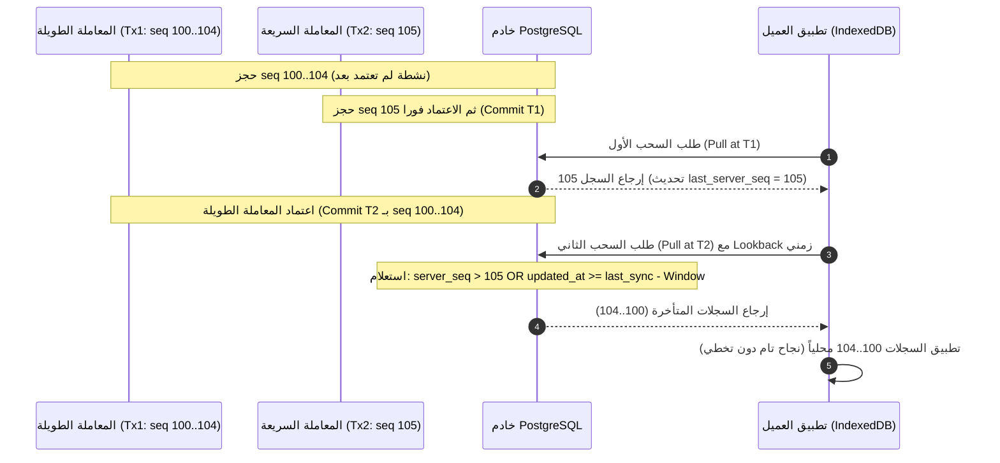

# توثيق معمارية المزامنة وبروتوكول السحب الآمن (Commit-Safe Sync Protocol)

## 1. التحدي الأساسي: تسلسل PostgreSQL والمعاملات المتزامنة غير المرتبة (Out-of-Order Commits)

في قواعد بيانات PostgreSQL:
- يتم حجز القيمة التسلسلية `server_seq = nextval('sync_seq')` لحظة تنفيذ جملة الاستعلام، **وليس لحظة الاعتماد (Commit)**.
- افترض معاملتين متزامنتين:
  - **المعاملة (Tx1):** معاملة طويلة (استيراد جماعي أو عملية معقدة) حجزت أرقام تسلسلية من `100` إلى `104`.
  - **المعاملة (Tx2):** معاملة سريعة في فرع آخر حجزت الرقم التسلسلي `105`.
- اعتمدت المعاملة Tx2 أولاً في التوقيت $T_1$.
- قام العميل (الجهاز المحمول) بسحب التحديثات، واستلم السجل رقم `105` وخزن المؤشر: `cursor = 105`.
- في التوقيت $T_2$، اعتمدت المعاملة Tx1 بالسجلات من `100` إلى `104`.
- **الفشل الكارثي في السحب البسيط:** إذا كان الاستعلام التالي يعتمد فقط على `WHERE server_seq > cursor` (أي `> 105`)، فإن السجلات من 100 إلى 104 **ستُفقد نهائياً وبصمت (Silent Data Loss)** ولن تصل للعميل أبداً!
- **لماذا يفشل التراجع بعدد ثابت (N-Sequence Lookback):** تحديد تراجع ثابت (مثل 100 تسلسل) غير كافٍ هندسياً؛ لأن عملية استيراد جماعي واحدة (Bulk Import) لـ 5,000 صنف ستستهلك 5,000 رقم تسلسلي، مما يتجاوز أي نافذة عددية ثابتة.

---

## 2. الإستراتيجية المعمارية المعتمدة (The Commit-Safe Architecture)

يعتمد النظام حلاً ثلاثي المستويات يضمن وصول كافة السجلات دون أي فقدان:



### أ. السحب الزمني المتداخل (Time-Based Overlap Window):
- يحفظ العميل مؤشرين رئيسيين:
  1. `last_server_seq`: أعلى رقم تسلسلي تم استلامه وتطبيقه.
  2. `last_sync_timestamp`: توقيت آخر عملية سحب ناجحة بتوقيت السيرفر (ISO Timestamp).
- عند تنفيذ الـ Pull، يرسل العميل طلب السحب مستخدماً النافذة الزمنية:
  ```sql
  WHERE server_seq > :last_server_seq 
     OR updated_at >= :last_sync_timestamp - INTERVAL '15 minutes'
  ```
  حيث إن الحد الأقصى لعمر المعاملة (`statement_timeout` / `idle_in_transaction_session_timeout`) على السيرفر مضبوط على دقيقتين؛ وبالتالي فإن نافذة 15 دقيقة تغطي أي معاملة متأخرة مهما بلغ حجم الاستيراد الجماعي دون التأثر بعدد التسلسلات المستهلكة.

### ب. خط أفق المعاملات النشطة (Postgres xmin Horizon - عند توفر Edge RPC):
- في دالة السحب المركزية على السيرفر:
  ```sql
  create or replace function get_sync_delta(client_seq bigint)
  ...
  -- يتم قراءة أفق المعاملات النشطة:
  select pg_snapshot_xmin(pg_current_snapshot()) into active_horizon;
  ```
  يضمن السيرفر عدم ترحيل أي تسلسل يقع ضمن المعاملات النشطة غير المعتمدة حتى تكتمل وتعتمد رسمياً.

### ج. قاعدة التحديث المحلي الصارم في Dexie (Local Idempotent Upsert Rule):
نظراً لأن السحب المتداخل سيعيد تسليم بعض السجلات القديمة، فإن المحرك المحلي يتبع القواعد التالية:
1. **فحص العمليات المعلقة (No Overwriting Pending Outbox):**
   إذا كان السجل المستلم لديه عمليات تعديل محلية في الـ Outbox بحالة `pending` أو `in_flight`، **يُمنع الكتابة الفوقية عليه نهائياً**، ويتم توجيهه إلى جدول `sync_conflicts` مع تسجيل الحالتين للمراجعة.
2. **المقارنة التسلسلية الصارمة (Strict server_seq Comparison):**
   ```typescript
   if (!localRow || serverRow.server_seq > localRow.server_seq) {
     await table.put(serverRow);
     return 'applied';
   }
   return 'skipped';
   ```
   **قاعدة حاسمة:** لا يوجد أي شرط `OR` بين `server_seq` و `version`. التحديث يطبق فقط إذا كان `server_seq` القادم أكبر قطيعاً من المحلي، مما يضمن أن السجلات القديمة المعادة لا تُرجع حالة الكيان إلى الوراء.

---

## 3. إثبات عدم التخطي (Proof of Non-Skipping)

1. إذا استلم العميل `server_seq = 105` لـ (الكيان A).
2. اعتمدت المعاملة المتأخرة `server_seq = 102` لـ (الكيان B).
3. في السحب التالي، تكتشف نافذة الاسترجاع الكيان B (`server_seq = 102`).
4. يبحث العميل محلياً عن الكيان B:
   - محلياً: الكيان B إما غير موجود أصلاً (`localRow === undefined`) أو تسلسله القديم كان `80`.
   - الشرط: `102 > 80` (متحقق).
   - النتيجة: يتم تطبيق الكيان B بنجاح تام، **ولا يتم تخطيه أبداً**.
